## Stat 386 Tutorial Blog – Matthew Davis

# Exploring Generative Adversarial Networks (GANs) For Image Generation

### What is a Generative Adversarial Network (GAN) and what is it used for? 

A GAN is a machine learning tool for image generation using a *generator* and a *discriminator* to challenge each other to make better and better computer generated content. 

#### The Generator

So what does this actually mean? In a GAN the *Generator's* job is to generate images. But how does the computer know what to generate? At first, it has no clue, and just comes up with nonsense. Fig1 is an example of a generators first attempt at generating an image. You can see that it's just a bunch of noise. 

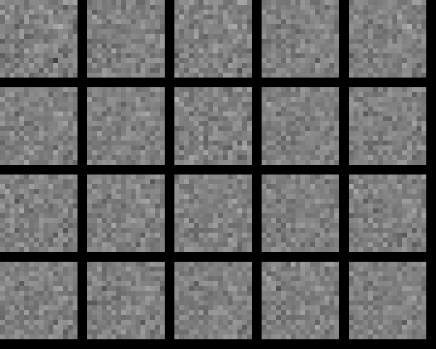

This noise is pretty useless, and the generator needs to learn somehow that it did a bad job generating the image, this is where the descriminator comes in. 

#### The Discriminator

The *Discriminator* compares the generated images with real images from a training dataset. In this example our dataset consists of small pixelated images of stars, see Fig2. 

::: {layout-ncol=5}

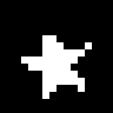

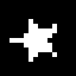

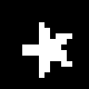

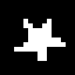

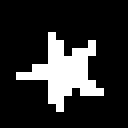

:::

**Fig2:** 5 Samples from the original dataset

The Discriminator looks at the real dataset, and the generated images and tries to determine (or discriminate) whether or not a given image is generated or real. 

The fun part of this is the Generator learns if it was able to beat the Discriminator or not, and the Discriminator learns if it was able to catch the Generator. They are constantly fighting against each other, to eventually make the best output. 

#### A Real World Example

> A Counterfeiter is trying to make fake money, and the Police are trying to catch him. It's a game of cops and robbers. The Counterfeiter makes their first $1 bill and uses it at a store. The Police find the bill and compare it to a *real* $1 bill to determine the one from the store is a fake. The Counterfeiter is caught! The Counterfeiter looks at the failed fake and tries again, changing some of the pieces of the $1 bill to make it look more realistic. He brings this $1 bill back to the store and tries to use it. When the bill is intercepted by the Police they check it against what they know as real money. This time, the fake bill looks so real that the Police can't tell the difference! The counterfeit bill never gets caught. 

In this story the Counterfeiter is the Generator and the Police are the Discriminator. One major difference to the real GAN system is that the Discriminator gets fed *real* images and *fake* images. The Discriminator has never seen a real image or a fake image, so each time it tries to predict (or discriminate) it gets immediate feedback on if it's right or wrong. This feedback is part of the ***backpropogation*** loop. 

The Generator is *also* receiving immediate feedback on whether it passed the Discriminator or not. If the Discriminator fails, the Generator learns that it did a good job generating an image. If the Discriminator succeeds the Generator learns that it did not do a good job generating an image. 

This system loops through thousands of times generating and discriminating images over and over again until the final Generator output consistently beats the Discriminator. 

We call these loops ***Epochs*** and we can see the progress throughout the epochs in the figures below. 

::: {layout-ncol=3}

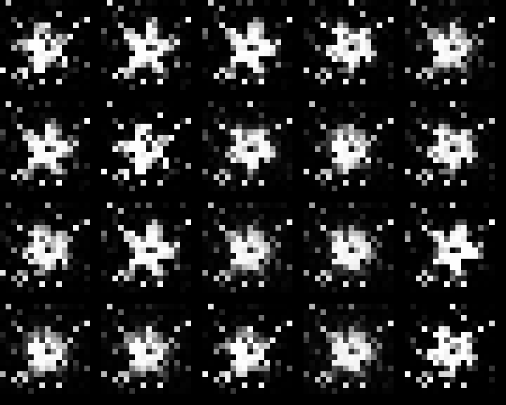

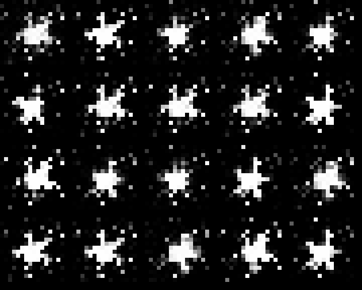

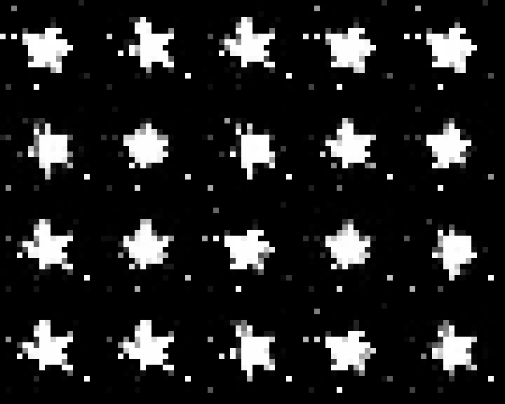

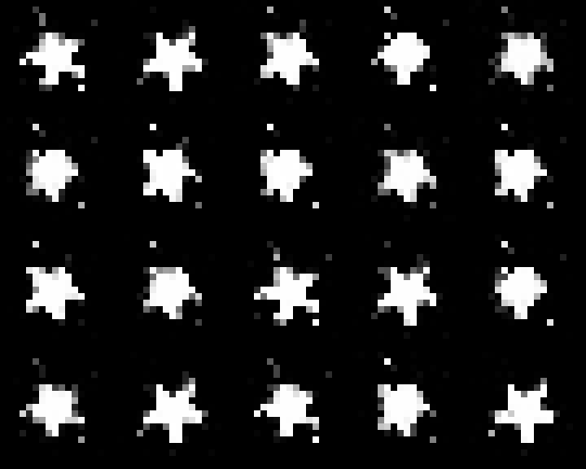

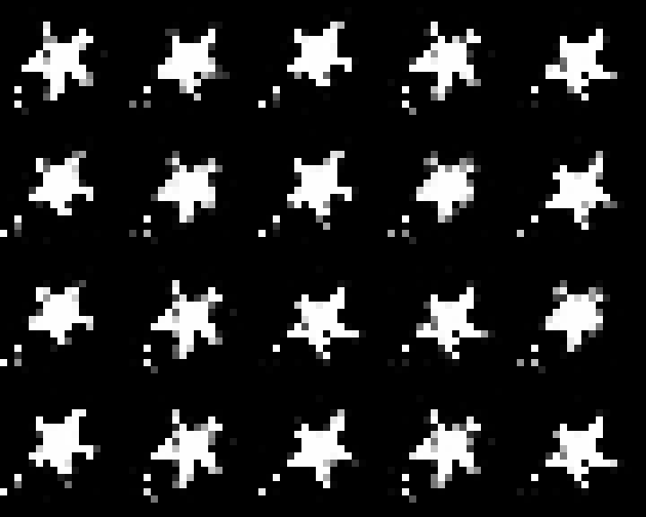

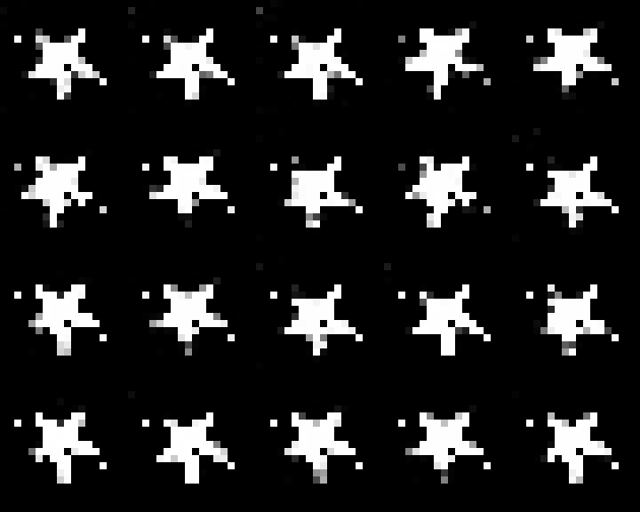

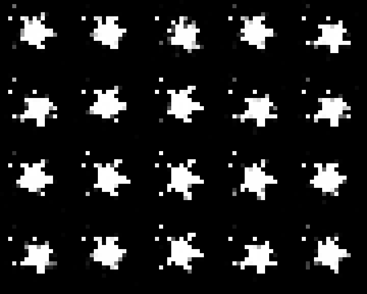

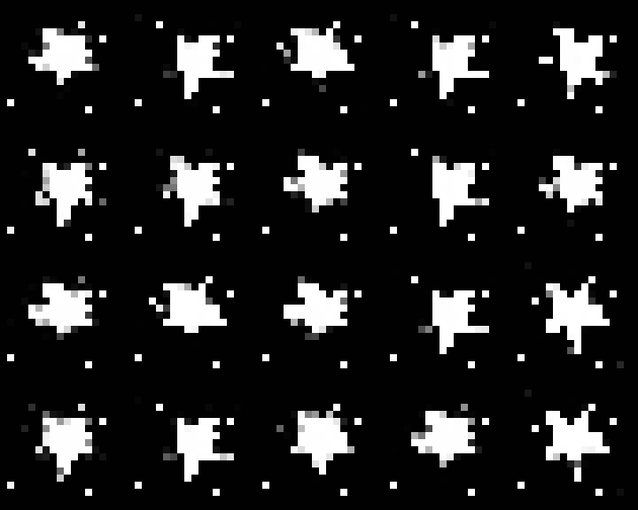

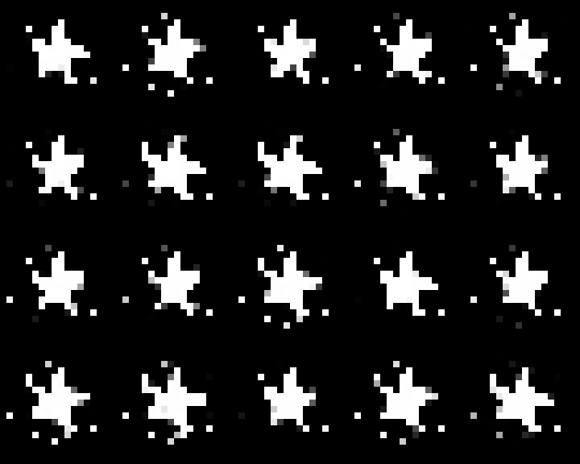

:::